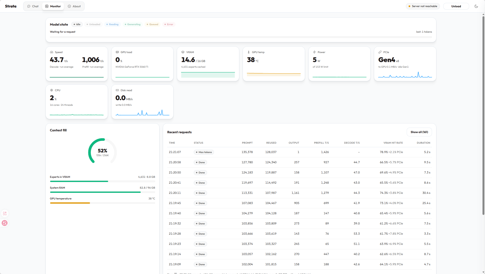
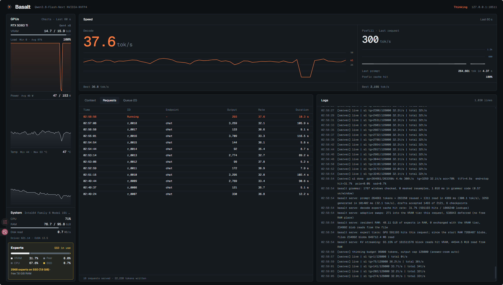

# RTX 5060 Ti Strata / Basalt / DSH Deployment

[中文说明](README_zh-CN.md)

A small collection of my local LLM deployment configurations for **Strata**, **Basalt**, and **DeepSeek Harness (DSH)**.

The setup is built around an **RTX 5060 Ti 16GB + 96GB DDR4** Windows machine and is mainly used to run **Qwen3.8-Flash-Next** with large system-memory expert offloading.

This repository is intended as a practical reference for running large MoE models on a single consumer GPU.

## Hardware & System

| Component | Configuration |
|---|---|
| OS | Windows 11 25H2, Build 26200.8655 |
| GPU | NVIDIA GeForce RTX 5060 Ti 16GB |
| CPU | Intel Q1K3 |
| P-Core | 4.6 GHz all-core |
| E-Core | 3.4 GHz all-core |
| Ring | 3.6 GHz |
| Memory | 96GB DDR4-3200 |
| Memory Timing | 16-20-38, Gear 1 |
| Motherboard | MSI PRO B760M-A DDR4 II |
| Strata Backend | 0.1.59 |
| Basalt | 0.4.1 |

## Repository Contents

```text
.
├── README.md
├── README_zh-CN.md
├── strata启动参数.txt
├── basalt启动参数.txt
├── dsh系统提示词.txt
├── basalt_bench.py
├── basalt_bench_20261119_204000_code.csv
├── basalt_bench_20261119_205011_prose.csv
└── images/
    ├── strata-monitor.png
    └── basalt-monitor.png
```

## Strata

Tested with **Strata backend 0.1.59**.

`strata启动参数.txt` contains the Strata launch configuration currently used for:

- **Model:** Qwen3.8-Flash-Next UD-IQ3_XXS
- **Context:** 512K
- **KV Cache:** INT8
- **Parallel:** 1
- **MTP:** enabled
- **Drafting:** MTP
- **Vision:** CPU
- **YaRN RoPE scaling:** enabled
- **RoPE scale:** 2
- **KV resident:** 20480 MiB
- **Prefill:** 8192
- **Speculative decoding:** `spec=4`
- **spec-min-p:** `0.7`
- **PCIe / expert I/O:** mmap
- **Port:** `18510`

The configuration is designed to keep the GPU close to full VRAM utilization while using system RAM for the remaining MoE experts.

### Strata Monitor



The screenshot above shows an example long-context workload on the RTX 5060 Ti system. It is included as a real-world operating example rather than a controlled benchmark.

## Basalt

Tested with **Basalt 0.4.1**.

`basalt启动参数.txt` contains the Basalt launch configuration currently used for:

- **Model:** Qwen3.8-Flash-Next NVFP4-DQ8
- **Context:** 512K
- **KV Cache:** INT8
- **Parallel:** 1
- **Vision:** CPU
- **Expert cache:** automatic
- **Resident experts:** enabled
- **Resident expert budget:** 56 GiB
- **YaRN RoPE scaling:** enabled
- **RoPE scale:** 2
- **Speculative decoding:** `spec=8`, MTP draft length `--mtp-max-t 4`
- **Suffix draft:** `--suffix-draft 3`
- **Prefill CPU share:** `--prefill-cpu-share 0.5`
- **Fit max tokens:** enabled (`--fit-max-tokens`)
- **Adaptive expert swapping:** `--adapt-every 1 --adapt-swaps 64 --adapt-decay 0.85`
- **Pool workers:** 8
- **Port:** `18511`

Basalt uses a combination of **VRAM, system RAM, and SSD-backed expert storage**, allowing a larger model quantization to run within the 16GB VRAM limit.

### Basalt Monitor



This screenshot shows an example Basalt session with experts distributed across VRAM, RAM, and SSD. Performance varies depending on expert-cache hit rate, context reuse, workload, and system state.

### Basalt Benchmark

`basalt_bench.py` is a dependency-free (standard library only) client for benchmarking a running Basalt server. For each context size it builds a synthetic prompt with a unique random prefix per request (so no KV-prefix reuse — every row reports `cached_tokens = 0`), sends it with thinking disabled and 2048 output tokens, and records client-observed prefill rate (prompt tokens / TTFT), stream decode rate, and the server's speculative-decoding timings.

```text
python basalt_bench.py --base http://127.0.0.1:18511 --workload code  --sizes 8k,32k,64k,128k,256k --output 2048
python basalt_bench.py --base http://127.0.0.1:18511 --workload prose --sizes 8k,32k,64k,128k,256k --output 2048
```

Results measured on 2026-11-19 with the tuned launch parameters above (Qwen3.8-Flash-Next NVFP4-DQ8, serial requests):

| Context | Code prefill (t/s) | Code decode (t/s) | Prose prefill (t/s) | Prose decode (t/s) |
|---:|---:|---:|---:|---:|
| 8K   | 1,351 | 44.1 | 1,373 | 35.8 |
| 32K  | 2,233 | 53.3 | 2,165 | 35.1 |
| 64K  | 2,374 | 43.8 | 2,369 | 37.0 |
| 128K | 2,327 | 45.2 | 2,367 | 36.6 |
| 256K | 2,180 | 45.1 | 2,190 | 32.7 |

Speculative acceptance (accepted / proposed draft tokens), which explains the decode gap:

| Context | Code accept | Prose accept |
|---:|---:|---:|
| 8K   | 82% | 72% |
| 32K  | 95% | 71% |
| 64K  | 81% | 70% |
| 128K | 83% | 70% |
| 256K | 84% | 71% |

Observations:

- **Prefill is workload-independent:** ~2.2–2.4K t/s from 32K up; the 8K row is lower because fixed per-request overhead (queueing, tokenization, first-chunk latency) dominates small prompts. Full 256K prefill takes about 2 minutes (TTFT ≈ 120 s).
- **Decode is workload-dependent:** code runs ~1.2–1.5× faster than prose (peak 53 t/s at 32K vs ~33–37 t/s), matching the acceptance rates — MTP + suffix draft predicts code tokens (~82–95%) far better than natural prose (~70–72%).
- Decode rate stays roughly flat from 8K to 256K; the 32K code run benefited from an unusually high 95% acceptance.

Raw rows (TTFT, totals, per-request server timings) are in `basalt_bench_20261119_204000_code.csv` and `basalt_bench_20261119_205011_prose.csv`.

## DeepSeek Harness

`dsh系统提示词.txt` contains the custom system prompt I use with **DeepSeek Harness**.

The prompt is designed for long-running coding and autonomous task execution, with emphasis on:

- execution-first behavior;
- continuing work instead of stopping at planning;
- context-window discipline;
- context compression discipline;
- avoiding invented context-usage estimates;
- reducing repetitive reasoning and unnecessary self-reflection;
- evidence-based investigation;
- verifying commands, edits, and test results;
- avoiding premature task completion;
- strict **single-agent execution**;
- completely disabling the use of sub-agents.

The goal is to make long-running DSH sessions more persistent and execution-oriented, especially for coding, debugging, repository inspection, and iterative development.

## Notes

These configurations are tuned for **my specific hardware and workloads**. They should be treated as reference configurations rather than universal optimal settings.

The behavior and optimal parameters may change across different versions of Strata and Basalt. The configurations in this repository were tested with:

```text
Strata backend: 0.1.59
Basalt:         0.4.1
```

Before using them, modify environment-specific values such as:

- model paths;
- Strata / Basalt installation paths;
- Conda paths;
- CPU affinity;
- available RAM and VRAM;
- resident expert budget;
- service ports;
- context length.

Performance may vary significantly with:

- Strata / Basalt version;
- model and quantization format;
- NVIDIA driver / CUDA version;
- CPU frequency;
- memory bandwidth and latency;
- PCIe configuration;
- SSD performance;
- expert-cache hit rate;
- context reuse ratio.

## Purpose

The goal of this repository is simple:

> Provide a working reference for running large MoE models such as Qwen3.8-Flash-Next on a single RTX 5060 Ti 16GB by combining GPU compute with large system-memory expert offloading.

Feel free to use, modify, benchmark, or improve these configurations.