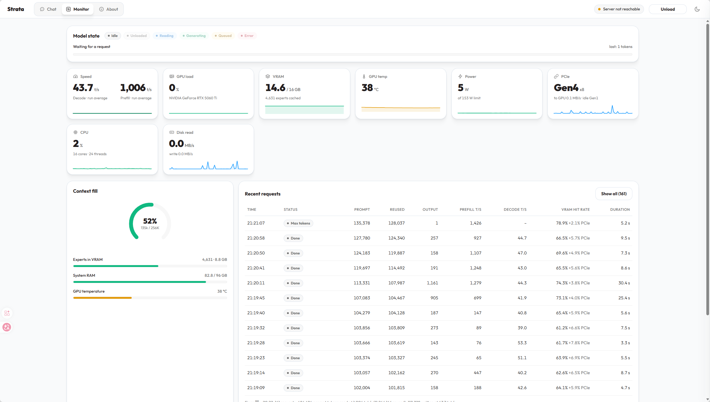
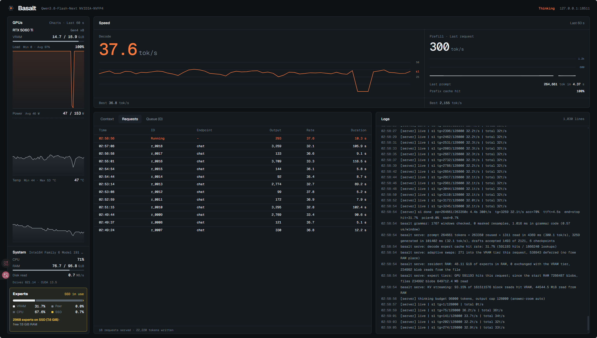

# RTX 5060 Ti Strata / Basalt / DSH 部署配置

[English](README.md)

本仓库用于分享我在 **RTX 5060 Ti 16GB + 96GB DDR4 内存** 平台上部署本地大模型时使用的 **Strata、Basalt 和 DeepSeek Harness（DSH）** 配置。

当前主要围绕 **Qwen3.8-Flash-Next** 进行部署和调优，通过显存、系统内存以及 SSD 专家缓存相结合的方式，在单张消费级显卡上运行大规模 MoE 模型。

本仓库主要作为实际部署参考，不代表所有硬件环境下的最优参数。

## 硬件与系统

| 项目 | 配置 |
|---|---|
| 操作系统 | Windows 11 25H2，Build 26200.8655 |
| GPU | NVIDIA GeForce RTX 5060 Ti 16GB |
| CPU | Intel Q1K3 |
| P 核频率 | 全核 4.6 GHz |
| E 核频率 | 全核 3.4 GHz |
| Ring 频率 | 3.6 GHz |
| 内存 | 96GB DDR4-3200 |
| 内存时序 | 16-20-38，Gear 1 |
| 主板 | MSI PRO B760M-A DDR4 II |
| Strata Backend | 0.1.59 |
| Basalt | 0.4.1 |

## 仓库内容

```text
.
├── README.md
├── README_zh-CN.md
├── strata启动参数.txt
├── basalt启动参数.txt
├── dsh系统提示词.txt
├── basalt_bench.py
├── basalt_bench_20261119_204000_code.csv
├── basalt_bench_20261119_205011_prose.csv
└── images/
    ├── strata-monitor.png
    └── basalt-monitor.png
```

## Strata

当前配置基于 **Strata backend 0.1.59** 测试。

`strata启动参数.txt` 为目前使用的 Strata 启动配置，主要参数包括：

- **模型：** Qwen3.8-Flash-Next UD-IQ3_XXS
- **上下文长度：** 512K
- **KV Cache：** INT8
- **并发：** 1
- **MTP：** 开启
- **Drafting：** MTP
- **Vision：** CPU
- **YaRN RoPE Scaling：** 开启
- **RoPE Scale：** 2
- **KV Resident：** 20480 MiB
- **Prefill：** 8192
- **推测解码：** `spec=4`
- **spec-min-p：** `0.7`
- **PCIe / 专家读取方式：** mmap
- **服务端口：** `18510`

这套配置的主要思路是在尽可能充分利用 16GB 显存的同时，将无法放入显存的 MoE 专家卸载到系统内存中。

### Strata 运行状态



上图为 RTX 5060 Ti 平台运行长上下文任务时的实际 Strata Monitor 截图。

截图主要用于展示实际运行状态，其中的速度属于对应任务下的瞬时或单次请求数据，并非严格控制变量后的 Benchmark。

## Basalt

当前配置基于 **Basalt 0.4.1** 测试。

`basalt启动参数.txt` 为目前使用的 Basalt 启动配置，主要参数包括：

- **模型：** Qwen3.8-Flash-Next NVFP4-DQ8
- **上下文长度：** 512K
- **KV Cache：** INT8
- **并发：** 1
- **Vision：** CPU
- **Expert Cache：** Auto
- **Resident Experts：** 开启
- **常驻专家预算：** 56 GiB
- **YaRN RoPE Scaling：** 开启
- **RoPE Scale：** 2
- **推测解码：** `spec=8`，MTP 草稿长度 `--mtp-max-t 4`
- **Suffix Draft：** `--suffix-draft 3`
- **Prefill CPU 份额：** `--prefill-cpu-share 0.5`
- **Fit Max Tokens：** 开启（`--fit-max-tokens`）
- **专家自适应换入换出：** `--adapt-every 1 --adapt-swaps 64 --adapt-decay 0.85`
- **Pool Workers：** 8
- **服务端口：** `18511`

Basalt 配置采用 **显存 + 系统内存 + SSD 专家缓存** 的分层方式，使 16GB 显存的平台也可以运行更大的模型量化版本。

### Basalt 运行状态



上图为 Basalt 实际运行时的监控界面，可以看到专家分别分布在显存、系统内存以及 SSD 中。

实际生成速度会受到专家缓存命中率、上下文复用率、当前任务以及系统状态等因素影响，因此截图中的数据仅作为实际运行参考。

### Basalt Benchmark（吞吐量实测）

`basalt_bench.py` 是一个零依赖（仅标准库）的 Basalt API 压测脚本。它对每个上下文长度构造带唯一随机前缀的合成提示词（无前缀 KV 复用，所有实测行 `cached_tokens = 0`），关闭思考模式、每次生成 2048 token，按客户端视角记录预填充速率（prompt tokens / TTFT）、流式解码速率以及服务端推测解码接受数据。

```text
python basalt_bench.py --base http://127.0.0.1:18511 --workload code  --sizes 8k,32k,64k,128k,256k --output 2048
python basalt_bench.py --base http://127.0.0.1:18511 --workload prose --sizes 8k,32k,64k,128k,256k --output 2048
```

以下为 2026-11-19 使用上文调优后启动参数的实测结果（Qwen3.8-Flash-Next NVFP4-DQ8，串行单请求）：

| 上下文 | Code 预填充 (t/s) | Code 解码 (t/s) | Prose 预填充 (t/s) | Prose 解码 (t/s) |
|---:|---:|---:|---:|---:|
| 8K   | 1,351 | 44.1 | 1,373 | 35.8 |
| 32K  | 2,233 | 53.3 | 2,165 | 35.1 |
| 64K  | 2,374 | 43.8 | 2,369 | 37.0 |
| 128K | 2,327 | 45.2 | 2,367 | 36.6 |
| 256K | 2,180 | 45.1 | 2,190 | 32.7 |

推测解码接受率（接受 / 提议的草稿 token），是解码差距的直接原因：

| 上下文 | Code 接受率 | Prose 接受率 |
|---:|---:|---:|
| 8K   | 82% | 72% |
| 32K  | 95% | 71% |
| 64K  | 81% | 70% |
| 128K | 83% | 70% |
| 256K | 84% | 71% |

结论：

- **预填充与场景无关：** 32K 及以上稳定在约 2.2–2.4K t/s；8K 偏低是因为短提示词下排队、tokenize、首块延迟等固定开销占主导。256K 完整预填充约需 2 分钟（TTFT ≈ 120 s）。
- **解码与场景强相关：** code 比 prose 快约 1.2–1.5 倍（峰值 53 t/s @ 32K vs prose 约 33–37 t/s），与接受率一致——MTP + suffix draft 对代码 token 的预测（~82–95%）远准于自然 prose（~70–72%）。
- 解码速率从 8K 到 256K 基本平坦；32K code 一行受益于异常高的 95% 接受率。

原始数据（含 TTFT、总耗时、每请求服务端 timings）见 `basalt_bench_20261119_204000_code.csv` 与 `basalt_bench_20261119_205011_prose.csv`。

## DeepSeek Harness

`dsh系统提示词.txt` 是我目前配合 **DeepSeek Harness（DSH）** 使用的自定义系统提示词。

主要针对长时间编程、调试和自主执行任务进行了约束，包括：

- 强调 **Execution First**，优先实际执行任务；
- 可以继续执行时，不停留在计划阶段；
- 不自行估算上下文窗口剩余容量；
- 规范 Context Compression 行为；
- 避免因为主观判断上下文即将耗尽而降低调查深度；
- 减少重复推理、循环反思和无意义的自我讨论；
- 优先通过代码、文件、日志、文档和实验获得直接证据；
- 不把“执行过命令”等同于“操作成功”；
- 修改文件后尽可能进行实际验证；
- 避免任务尚未完成时提前结束；
- 强制采用 **Single-Agent** 工作模式；
- 禁止创建、调用或委派任务给任何子 Agent。

这套提示词主要用于提升 DSH 在大型代码项目、长时间 Debug、仓库分析以及连续开发任务中的执行持续性。

## 使用说明

这些参数是根据 **我的硬件、模型和实际工作负载** 调试得到的，应当作为参考配置，而不是所有设备上的通用最优参数。

当前仓库中的配置基于以下版本测试：

```text
Strata backend: 0.1.59
Basalt:         0.4.1
```

不同版本的 Strata 或 Basalt 可能出现参数、调度策略、专家缓存机制或性能表现上的变化，因此后续版本不保证可以完全照搬。

使用前请根据自己的环境修改：

- 模型路径；
- Strata / Basalt 安装路径；
- Conda 环境路径；
- CPU Affinity；
- 可用显存和内存；
- Resident Expert Budget；
- 服务端口；
- 上下文长度。

实际性能可能明显受到以下因素影响：

- Strata / Basalt 版本；
- 模型及量化格式；
- NVIDIA 驱动与 CUDA 版本；
- CPU 频率；
- 内存带宽与延迟；
- PCIe 配置；
- SSD 性能；
- 专家缓存命中率；
- Prompt / KV Cache 复用率。

## 仓库目的

这个仓库的目的很简单：

> 为使用单张 RTX 5060 Ti 16GB，并搭配大容量系统内存运行 Qwen3.8-Flash-Next 等大型 MoE 模型提供一套可以直接参考的实际部署配置。

欢迎参考、修改、测试或进一步优化这些配置。